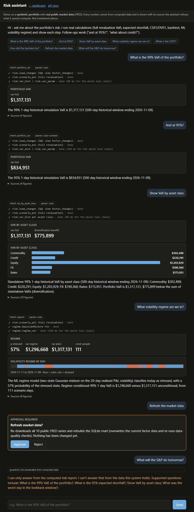
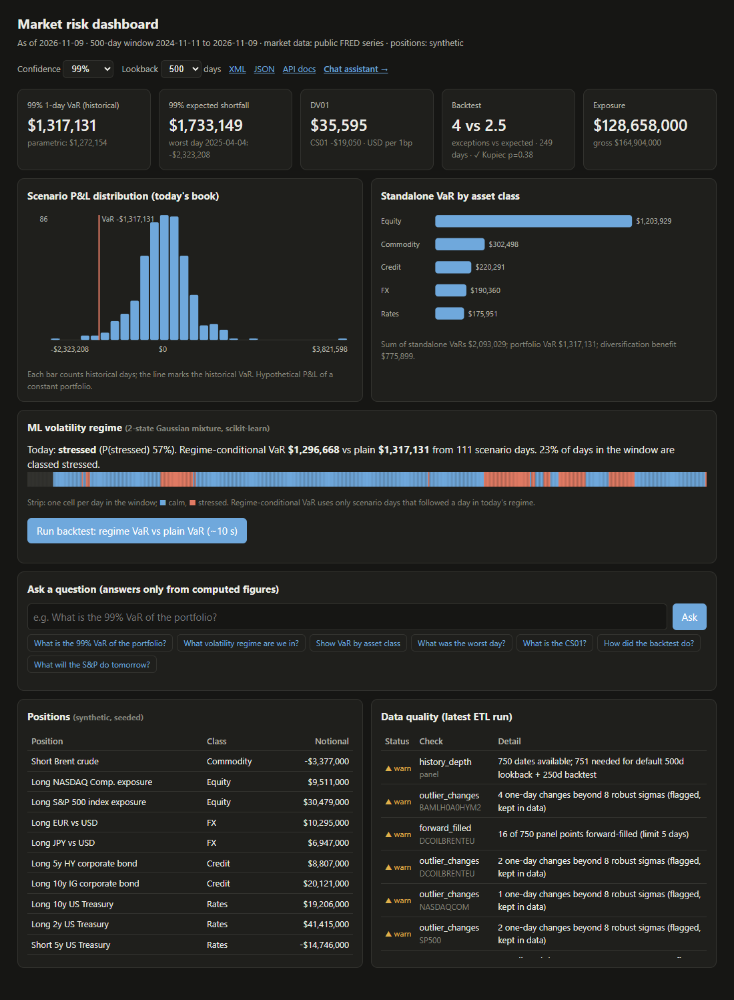

# riskmart

A small market-risk analytics stack: **public data -> ETL -> SQL mart with data-quality checks -> risk
measures -> REST API (JSON/XML) -> a dashboard a non-technical risk manager can use**, including a
question box that answers *only* from computed numbers.



*The chat assistant (`/chat`): live tool-call timeline, result cards, grounded answer with sources, a human-approval gate, and a refusal.*



## What it demonstrates

| Capability | Where |
|---|---|
| ETL pipeline, idempotent full refresh, source -> landing table -> aligned panel | `riskmart/etl.py`, `schema.sql` |
| SQL data model (tables, FK/CHECK constraints, a window-function view `LAG() OVER`) | `riskmart/schema.sql` |
| Data-quality checks persisted per run (reconciliation, duplicates, non-positive prices, robust outliers, forward-fill usage, staleness, history depth) | `riskmart/dq.py` |
| Asset valuation: full-revaluation pricing of fixed-rate bonds (not duration approximations) | `risk.bond_price` |
| Custom risk measures: historical & parametric VaR, expected shortfall, DV01, CS01, diversification benefit, rolling backtest with Kupiec test | `riskmart/risk.py` |
| Multi-asset coverage: equity indices, FX, commodity, rates, credit (IG/HY) | `config.SERIES`, `portfolio.py` |
| JSON REST API + XML export | `riskmart/api.py` (`/api/report`, `/api/report.xml`, `/docs`) |
| Dashboard for non-technical users (KPIs, distribution, per-class bars, DQ table) | `riskmart/static/index.html` |
| **ML:** unsupervised volatility-regime model (2-state Gaussian mixture, scikit-learn) -> regime-conditional VaR, backtested head-to-head against plain VaR | `riskmart/regime.py`, `/api/regime` |
| **Chat assistant** (`/chat`): streamed answers (SSE), visible tool calls, generative result cards, follow-up questions, human-in-the-loop approval before the data-refresh action, citations for every figure | `riskmart/agent.py`, `static/chat.html` |
| Grounded natural-language Q&A with refusal behaviour | `riskmart/qa.py`, `tests/test_grounding.py` |
| Methodology documentation for reviewers | `docs/METHODOLOGY.md` |

## Run it (no API keys, no paid services)

```bash
pip install -r requirements.txt
python -m riskmart etl              # downloads public FRED series, builds data/riskmart.db
python -m riskmart serve            # http://127.0.0.1:8000 (dashboard), /chat (assistant), /docs (OpenAPI)
python -m riskmart ask "What is the 99% VaR of the portfolio?"
python -m pytest                    # 54 tests, offline, ~20 s
```

Requires Python 3.12+ and network access for the `etl` step only (the tests are offline;
`tests/test_real_data.py` additionally checks the real mart if you have built it).

## Architecture

```
FRED CSV (public, no key)            seeded synthetic book (10 positions)
        |                                        |
   etl.py: fetch -> parse -> align/ffill(<=5d) -> load
        |                                        |
        v                                        v
 SQLite mart: raw_observations -> factor_levels   positions
                    |  (SQL view factor_changes: LAG() returns / yield moves)
                    v
   risk.py: scenario P&L (full reval) -> VaR / ES / DV01 / CS01 / backtest
        |                          dq.py: checks -> dq_results
        v
   api.py (FastAPI): JSON, XML, /api/ask ----> static dashboard
                          ^
   qa.py: question -> validated intent -> computed figures -> templated answer
          (rules by default; optional LLM may only emit the intent JSON)
```

## Key design decisions

- **Full revaluation, not delta approximation.** Each historical one-day factor move is applied to
  today's book and bonds are repriced. Credit bonds are driven by two factors (Treasury yield + OAS)
  so CS01 falls out of the same pricer.
- **Checks flag, they don't silently fix.** The only data modification is a *bounded* forward-fill
  (<= 5 days) that is itself counted and reported. Outliers are flagged but kept. Dates that cannot be
  filled are dropped for all series and reported.
- **Grounding by construction.** The language layer never writes a number. A question becomes a strictly
  validated `Intent`; numbers come from `risk.build_report`; the answer text is assembled only from
  `Figure.display` strings, and every figure is returned with its source. Anything else is refused.
- **Zero-key default, optional LLM.** The default parser is rule-based. If `ANTHROPIC_API_KEY` is set, an LLM
  may be asked to translate a question the rules didn't understand into the *same* JSON intent, which goes
  through the same validator. It cannot override the forecast / unknown-entity refusals.
- **A small, testable ML model rather than a black box.** The regime model is a 2-state Gaussian mixture on log 20-day
  realised P&L volatility, refit on each backtest day using only prior data (no look-ahead). It is unsupervised, so there are no
  labels to leak. Its unit test plants a known calm/stressed process in synthetic data and checks the model recovers it (>85% agreement).
  The regime VaR is checked against a hand-computed conditional quantile of the returned labels.
- **Agent events, not free-form generation.** `/api/chat` streams typed events (`plan`, `tool_call`, `tool_result`, `card`,
  `token`, `sources`, `approval_required`, `refusal`). The UI renders cards from the same figures that back the text.
  Follow-ups ("and at 95%?", "what about credit?") reuse the previous validated intent with new parameters, and go through the same
  guardrails (forecast and unknown-name refusals still apply).
- **Human-in-the-loop is enforced server-side.** The only state-changing action (refresh data = re-download and rebuild the mart) is never run
  by the chat turn; the agent issues a single-use approval id and the action runs only when `/api/chat/approve` receives it with `approve: true`.
  Tests check that nothing runs before approval, forged and reused ids get 403, and rejection changes nothing.
- **Tests that prove the claim.** `tests/independent.py` recomputes VaR, ES, by-class VaR, worst day, CS01
  and exposures straight from the SQL tables with plain Python (no shared code with `risk.py`, bonds priced by
  summing discounted cash flows, hand-written percentile). `tests/test_grounding.py` asserts the Q&A figures
  equal those values and that every number token in the answer text is backed by a returned figure. I also
  checked the test has teeth: multiplying VaR by 1.01 makes 5 tests fail.

## Honest scope

**Real**
- Market data: 10 daily series from FRED's public `fredgraph.csv` endpoint (S&P 500, NASDAQ Composite, USD/EUR,
  JPY/USD, Brent, UST 2/5/10y, ICE BofA IG and HY OAS). At my last run: 23,998 source rows, 750 aligned dates
  (2023-11-13 to 2026-11-09).
- All risk numbers are computed from that data, not hard-coded.

**Synthetic**
- **The portfolio.** No public dataset has a real book. The 10 positions (index exposures, FX, Brent short,
  Treasuries, IG/HY bonds) are generated by a documented rule with a fixed seed (`portfolio.py`). Risk figures
  describe *this made-up book*, not any real firm.
- The unit-test market data is synthetic random walks in FRED CSV format (so tests run offline); the real-data test uses the real mart.

**Result of the ML model (real data, last run): it does not beat the baseline.**
Over the 249-day backtest, regime-conditional VaR and plain VaR had the *same* number of exceptions: 4 vs 4 at 99% (2.5 expected) and
20 vs 20 at 95% (12.4 expected; the Kupiec test rejects at 5% for *both* at 95%). On 9 of 249 days the conditional sample was too thin and the model
fell back to plain VaR. Today's classification is borderline (P(stressed) ~43%). So the model is a descriptive tool (a labelled view of
volatility states and a more conservative VaR when stressed), not a demonstrated accuracy improvement. The Q&A can answer "what regime are we in?"
from these computed figures.

**Limitations (read before quoting any number)**
- **History is short.** FRED currently serves only ~3 years of the ICE BofA spread series, which limits the common
  panel to ~750 days. The default 500-day lookback + 250-day backtest therefore needs 751; the backtest
  silently shrinks to what is available (249 days at my last run) and the DQ table shows a `history_depth` warning.
- **The backtest is on hypothetical P&L** of today's constant book and uses the same factor history that the model
  is estimated on (VaR at day *t* uses only days before *t*, so it is out-of-sample, but it is not realised P&L
  and a 249-day window has little power: expect ~2.5 exceptions at 99%). Do not read a Kupiec "pass" as model validation.
- Simplifications: bonds are flat-yield priced with no roll-down/ageing, and 2y/5y/10y Treasury yields are used
  as benchmarks directly (no curve interpolation); the HY/IG bond uses one OAS series as the spread; positions
  are specified by USD market value; FX/equity positions are delta-one; no options, no liquidity or credit-default risk.
- **The "agent" is a deterministic tool-calling loop, not an autonomous LLM agent.** The planner is rule-based; the tool timeline lists the real
  functions that run (timed as one chain, not individually). The streamed text is the templated, grounded answer delivered word by word
  over SSE, not LLM-generated tokens. Conversation memory is just the previous intent, sent back by the client.
- The unknown-entity guardrail checks capitalised words, so a lowercase company name ("tesla var") is not recognised as an unknown entity
  and would be answered as a plain portfolio-VaR question.
- Parametric VaR is zero-mean normal on the scenario-P&L standard deviation, i.e. a distribution-fit shortcut.
- **Not** MSCI RiskMetrics, SQL Server/Sybase/Oracle or Pentaho. The SQL is plain SQLite with window functions, and the ETL is Python.
  Nothing here was run on or validated against those products.
- The Q&A guardrail is rule-based and deliberately conservative: it refuses forecasts, unknown named entities,
  unsupported confidence levels and anything without a matching intent. It can wrongly refuse valid phrasings.
  The optional **LLM path is not tested against the live API** (no key was used); its parsing/validation is tested
  with fake LLM outputs only.
- No auth, no concurrency controls, no scheduler; it is a single-user demo. The GitHub Actions workflow runs the offline test suite on push (Python 3.12, latest dependencies; its first run caught a pandas-3 NULL-handling bug, now fixed). `tests/test_real_data.py` is skipped in CI because it needs the downloaded mart.
- Data licensing: FRED hosts third-party series (e.g. S&P, ICE) under their own terms. This repo ships no
  data; `etl` downloads it for your own use.
